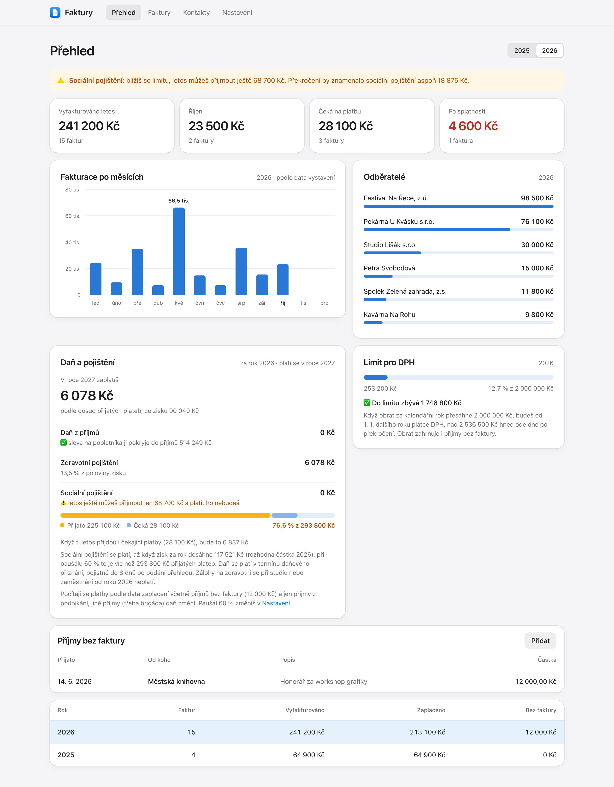

<p align="center">
  
</p>

<h1 align="center">Faktury</h1>

<p align="center">
  Jednoduchá fakturace pro živnostníky, kteří nejsou plátci DPH.<br>
  Běží na tvém Macu a data zůstávají u tebe. Bez účtu, bez předplatného a bez limitu faktur nebo kontaktů.
</p>

<picture>
  <source media="(prefers-color-scheme: dark)" srcset="docs/prehled-dark.png">
  
</picture>
<p align="center"><sub>Přehled s ukázkovými daty</sub></p>

## Pro koho to je

Pro OSVČ v Česku (živnostníky i svobodná povolání), kteří:

- **nejsou plátci DPH**,
- počítají daň s **výdajovým paušálem** (nebo výdaje neřeší),
- chtějí vystavit fakturu za minutu a mít přehled, kolik zaplatí na dani a pojištění.

Hodí se i při podnikání během studia nebo vedle zaměstnání (vedlejší činnost). Appka hlídá limit, do kterého se neplatí sociální pojištění.

## Co umí

- **Faktury v PDF s QR Platbou.** Číselná řada se vede sama a variabilní symbol se bere z čísla faktury. Fakturu můžeš upravit, duplikovat nebo stornovat (PDF pak dostane vodoznak).
- **Kontakty s načtením z ARES.** Stačí zadat IČO a název s adresou se doplní.
- **Přehled za rok:** příjmy po měsících, největší odběratelé, co čeká na platbu a co je po splatnosti.
- **Odhad daně a pojištění** z přijatých plateb a výdajového paušálu.
- **Hlídání limitů:** obrat pro registraci k DPH a rozhodná částka pro sociální pojištění. Varuje už při psaní faktury, která by limit přetáhla.
- **Příjmy bez faktury** (třeba vyúčtování od pořadatele) i s přiloženým dokladem.
- **Zálohy:** každý den automaticky, po každé změně kopie do iCloud Drive. Smazané PDF se jen přesunou stranou.
- **Import starých faktur** z JSON souboru i s původními PDF.

Faktury jsou v korunách a appka je česky.

## Požadavky

- **Jen macOS.** Instalace, spouštěč, záloha do iCloudu i tlačítko „Ukázat ve Finderu“ jsou psané pro Mac. Jádro je Python a webová stránka, ale na Linuxu ani Windows to vyzkoušené není.
- **Python 3.9 nebo novější.** Stačí ten ze systému: když chybí, macOS ho při prvním spuštění nabídne doinstalovat (nebo `xcode-select --install`). Jde to i s Pythonem z Homebrew. Žádné další balíčky nejsou potřeba.
- Internet jen pro načítání firem z ARES. Všechno ostatní funguje offline.

## Instalace a spuštění

Stáhni repozitář (`git clone` nebo Code → Download ZIP), dej složku tam, kde má natrvalo zůstat (třeba do Dokumentů), a spusť v ní:

```sh
./instalovat.sh
```

Skript vytvoří **Faktury.app** ve složce Aplikace. Pak ji spustíš přes Spotlight (⌘ mezerník → „Faktury“), Launchpad nebo Finder → Aplikace.
Otevře se v prohlížeči na adrese http://localhost:8765.

Faktury.app jen spustí `spustit.sh` z této složky. Když složku projektu přesuneš, spusť `./instalovat.sh` znovu.

Při prvním spuštění se macOS zeptá, jestli smí Faktury přistupovat ke složce Dokumenty a k iCloud Drive. Klikni na **Povolit**.
Když omylem zakážeš: Nastavení systému → Soukromí a zabezpečení → Soubory a složky → Faktury.

Než vystavíš první fakturu, vyplň v **Nastavení** svoje údaje, číslo účtu a výdajový paušál.

## Soukromí

Appka nemá žádný vlastní server ani účet a nic nikam neposílá. Data leží jen ve složce `data` u tebe na disku a v kopii na tvém iCloud Drive.
Jediný dotaz ven jde do veřejného registru ARES, když načítáš firmu podle IČO.
Appka poslouchá jen na `127.0.0.1`, takže se k ní nedostane nikdo jiný ze sítě.

## Kde jsou data

| Cesta | Co obsahuje |
|---|---|
| `data/faktury.json` | faktury, kontakty, nastavení (čitelný text) |
| `data/archiv/ROK/` | PDF všech faktur a doklady k příjmům bez faktury |
| `data/zalohy/` | automatická záloha před první změnou každého dne (30 dní) a před každým importem |
| `data/smazane/` | PDF smazaných faktur a dokladů (nic se nemaže natrvalo) |
| iCloud Drive → `Faktury záloha` | kopie všeho výše, aktualizuje se po každé změně |

Složka `data` se do gitu záměrně neukládá, protože obsahuje osobní údaje klientů.
Stav zálohy do iCloudu je vidět v Nastavení. Z iCloudu se nic nemaže, kromě denních záloh starších než 30 dní.

**Obnovení:** zavři appku (`kill $(cat data/server.pid)`) a jedním z těchto způsobů vrať soubor `data/faktury.json`:
- zkopíruj na jeho místo vybraný soubor z `data/zalohy`,
- nebo celý obsah složky `Faktury záloha` z iCloud Drive zkopíruj do `data/`.

## Daň a pojištění

Přehled ukazuje, kolik za vybraný rok zaplatíš v dalším roce: daň z příjmů a u vedlejší činnosti i zdravotní a sociální pojištění (částka může vyjít i 0 Kč).
Zisk se počítá jako přijaté platby (včetně příjmů bez faktury) minus výdajový paušál a paušál se nastavuje v Nastavení.

- **Daň:** 15 % ze zisku zaokrouhleného dolů na stovky minus sleva na poplatníka (30 840 Kč).
- **Zdravotní pojištění:** 13,5 % z poloviny zisku. Při studiu nebo zaměstnání se od roku 2026 neplatí zálohy a celé pojistné se doplácí po podání přehledu.
- **Sociální pojištění:** 29,2 % z 55 % zisku, ale jen když zisk za rok dosáhne rozhodné částky. Měřák v kartě hlídá, kolik ještě můžeš přijmout.
- **DPH:** když obrat za kalendářní rok přesáhne 2 000 000 Kč, budeš plátce od 1. 1. dalšího roku. Nad 2 536 500 Kč hned ode dne po překročení.

Počítá se jen s příjmy z podnikání. Jiné příjmy (třeba brigáda), skutečné výdaje a sazba daně 23 % pro velmi vysoké příjmy se nezohledňují.

**Varování u limitů:** u DPH, sociálního pojištění a hranice, kterou ještě pokryje sleva na dani, appka ukazuje ✅ / ⚠️ (od 75 %) / 🔴 (od 90 %, po překročení nebo když by limit přetáhly čekající platby).
Upozornění jsou nahoře v Přehledu (za letošek), v měřácích a ve formuláři faktury i příjmu, když by částka limit přetáhla.
Hranice 75 % a 90 % se mění v `static/charts.js` (`LIMIT_WARN`, `LIMIT_BAD`).

> Částky jsou orientační a platí pro roky 2025 a 2026. Daňové přiznání ani přehledy pro pojišťovny appka nevyplní a nenahrazuje účetní ani daňového poradce.

## Příjmy bez faktury

Peníze, které ti přišly bez vystavené faktury (třeba vyúčtování od pořadatele), zapíšeš přes Faktury → **Příjem bez faktury**.
Vyplníš datum přijetí, částku a od koho peníze přišly. Volitelně přiložíš doklad (PDF, PNG nebo JPG).
Takový příjem se nepočítá do číselné řady faktur, ale započítá se do daně a pojištění i do obratu pro DPH.
V Přehledu je vidět v tabulce za daný rok a kliknutím ho upravíš nebo smažeš.

## Pro vývoj

```sh
python3 server.py --open                  # ruční spuštění
python3 -m unittest discover tests        # testy
python3 import_data.py soubor.json --zkouska   # import starých dat (formát popsán v souboru)
```

Bez závislostí: Python ze systému nebo z Homebrew, backend na standardní knihovně a frontend v čistém JavaScriptu.
PDF vytváří knihovna pdfmake, přibalená ve `static/vendor`.
Testovací data: `FAKTURY_DATA=/jina/slozka FAKTURY_PORT=8799 python3 server.py`. Do iCloudu se zálohují, jen když nastavíš `FAKTURY_ICLOUD`.

**Každý rok** je potřeba zkontrolovat sazby a limity na začátku `static/app.js`:
- doplnit rozhodnou částku pro sociální pojištění do `SOCIAL_LIMITS` (zveřejňuje se na podzim předchozího roku, 2026: 117 521 Kč),
- od roku 2027 se má vrátit sleva na studenta 4 020 Kč. Až bude platit, je potřeba ji přičíst k `TAX_CREDIT`.

## Licence

[MIT](LICENSE). Přibalená knihovna [pdfmake](https://github.com/bpampuch/pdfmake) je pod licencí MIT a písmo Roboto pod licencí Apache 2.0.
